<p align="center">
  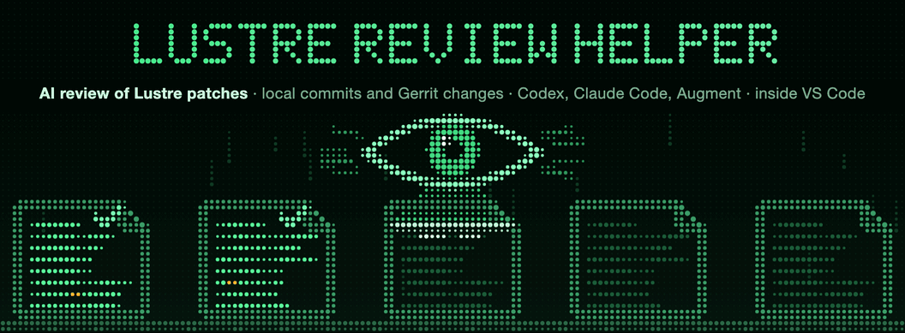
</p>

<p align="center">
  <b>AI patch review for Lustre, right inside VS Code.</b><br>
  Review your local commits and Gerrit changes with <b>Codex</b>, <b>Claude Code</b> or <b>Augment</b> using the Lustre review protocol,<br>
  read every finding where it belongs in the diff, and publish to Gerrit only when you decide to.
</p>

<p align="center">
  
  
  
  
  
  
</p>

<p align="center">
  <a href="#quick-start">Quick start</a> ·
  <a href="#a-tour">A tour</a> ·
  <a href="#how-it-works">How it works</a> ·
  <a href="#self-review-over-mcp">Self-review over MCP</a> ·
  <a href="docs/REFERENCE.md">Full reference</a>
</p>

---

<table>
<tr>
<td width="50%" valign="top">
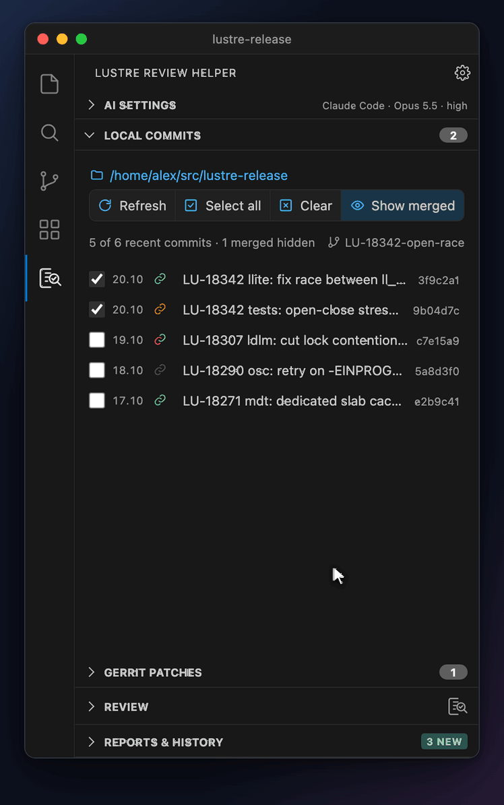
</td>
<td width="50%" valign="top">

### What it does

Lustre Review Helper puts [`lreview`](https://github.com/lustre-tools/llm_code_and_review_tools), the review
toolchain of LLM Code and Review Tools, in the VS Code sidebar. Tick the commits you want reviewed, add Gerrit changes, pick
an agent and a model, and press **Start review**.

Every commit and every patchset is reviewed **separately**, in its own Git
worktree pinned to its exact SHA, by the same deep-dive Lustre protocol that
`lreview` runs from the command line. Your working tree and uncommitted edits
are never touched.

While it runs you see each review's state, the tokens and cost so far, and an
eye that sweeps a laser down files of machine code. When it is done, the
findings are sorted by severity, each review has its own report, and nothing
has been sent anywhere.

</td>
</tr>
</table>

## Highlights

<table>
<tr>
<td width="33%" valign="top">

**🔍 The Lustre protocol**<br>
The `review-core` deep dive of [review-prompts](https://github.com/verygreen/review-prompts), or a cheap single-pass **Light** review.

</td>
<td width="33%" valign="top">

**🤖 Your agent, your model**<br>
Codex, Claude Code or Augment (Auggie CLI). Models and reasoning levels come straight from the installed client.

</td>
<td width="33%" valign="top">

**🧵 Local and Gerrit together**<br>
Local commits and Gerrit patchsets in one batch, reviewed in parallel, each in its own worktree.

</td>
</tr>
<tr>
<td valign="top">

**💬 Findings in the diff**<br>
VS Code's multi-file diff with every finding as a comment thread under its line, plus open Gerrit discussions.

</td>
<td valign="top">

**🔒 Publish on purpose**<br>
Locked until you unlock it. Shows other AI reviews and newer patchsets first, and allows one AI review per patchset across all your windows.

</td>
<td valign="top">

**🔌 Self-review over MCP**<br>
Your coding agent can review its own commit, read the findings, fix them and review again.

</td>
</tr>
<tr>
<td valign="top">

**📥 What waits for you on Gerrit**<br>
Waiting Review and In progress lists with CI, votes, owner replies and other AI reviews.

</td>
<td valign="top">

**📊 Live usage**<br>
Tokens, cost, elapsed time and account limits while you review, plus all-time totals per model.

</td>
<td valign="top">

**🌍 Six languages**<br>
English, Deutsch, Español, 日本語, 简体中文 and Русский, following VS Code by default.

</td>
</tr>
</table>

## Quick start

> **Note.** Lustre Review Helper runs on **Linux and macOS**. On Windows, open
> the project through **Remote WSL** or **Remote SSH** and install everything
> on that side.

**1. Install the extension.** Search for **Lustre Review Helper** in the
Extensions view of VS Code and click **Install**. Or take the `.vsix` of a
[release](https://github.com/vk-en/lustre-review-helper/releases) and choose
**Extensions: Install from VSIX…**.

**2. Install the review tools.** The reviews themselves run in
[`lreview`](https://github.com/lustre-tools/llm_code_and_review_tools), with `gerrit-cli` and `gerrit-dashboard` for Gerrit
(Python 3.11+ and Git):

```bash
git clone https://github.com/lustre-tools/llm_code_and_review_tools.git
cd llm_code_and_review_tools
./install.sh --venv
```

This installs `lreview`, `gerrit-cli`, `gerrit-dashboard` and the review prompts.

**3. Sign in to an agent.** You need only the one you plan to use:

| Agent | What to install | Sign in |
| --- | --- | --- |
| **Codex** | the Codex VS Code extension or CLI | `codex login`, or the **Sign in** button |
| **Claude Code** | the Claude Code VS Code extension or CLI | `claude auth login`, or **Sign in** |
| **Augment** | the [Auggie CLI](https://docs.augmentcode.com/cli/setup-auggie/install-auggie-cli): `npm install -g @augmentcode/auggie` | `auggie login`, or **Sign in** |

**4. Review.** Open your Lustre checkout, trust the workspace, and click the
**Lustre Review Helper** icon in the Activity Bar. Tick a commit and press
**Start review**.

> **Tip.** Everything the extension needs shows up under **AI Settings → Utilities** and
> **Accounts**, with a yellow dot on any tab that needs attention and a button
> that fixes it. If `lreview` is not on VS Code's `PATH`, point
> **Lustre Review: Lreview Path** at it, for example
> `/path/to/llm_code_and_review_tools/.venv/bin/lreview`.

## A tour

The panel is one accordion of five sections: **AI Settings**, **Local
commits**, **Gerrit patches**, **Review** and **Reports & History**. Opening one
folds the others away, and the headers stay in view with their counters.

### Local commits

The newest commits of your branch, each with its date, a link icon for its
change on Gerrit and its short hash.

- The link is **green** when Gerrit has this very commit, **orange** when Gerrit
  has another version of it, **blue** once merged, grey when it is not on Gerrit.
  Half of it turns **red** when Gerrit cannot merge the change.
- Hover a commit for its details, click it for its diff, and click the link to
  open the change.
- Commits that already landed on your base branch are hidden until you press
  **Show merged**.

### Gerrit patches

<table>
<tr>
<td width="50%" valign="top">

Three tabs. **Gerrit URL** adds any change by its URL. **Waiting Review** lists
the changes where you are a reviewer and have not reviewed yet. **In
progress** lists the ones you already looked at: a **new patchset** since your
review, an **owner reply**, still waiting for the author, or your own +1.

- Each change shows its patchset, CI (build and tests, with failing test
  names), Code-Review votes as slots, and whether anyone already posted an AI
  review of it.
- **Tick a change** to add its current patchset to the next review.
- Choose **List**, **Cards** or **Groups**, and filter out what you do not
  need, such as running CI.
- The lists refresh by themselves every five minutes, shared by all windows
  of the project.

</td>
<td width="50%" valign="top">
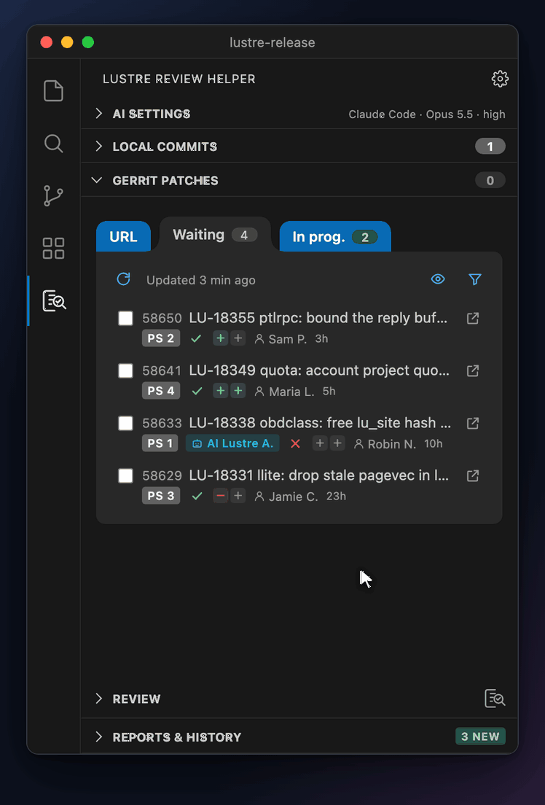
</td>
</tr>
</table>

### Review

Start a batch and the selection turns into a progress list: a spinner and a
clock for each review that runs, *queued* for the ones that wait, then a dot in
the color of the worst finding, the findings by kind and the time it took.
Below it, the agent, model and reasoning, a status pill, and one line of live
numbers: elapsed time, tokens, cost and reviews done. For Codex and Claude Code
the card also shows how much of your account limits is left.

Click a finished review to open its report. **Cancel** stops the batch and
keeps what is already done.

### Reports & History

<table>
<tr>
<td width="50%" valign="top">
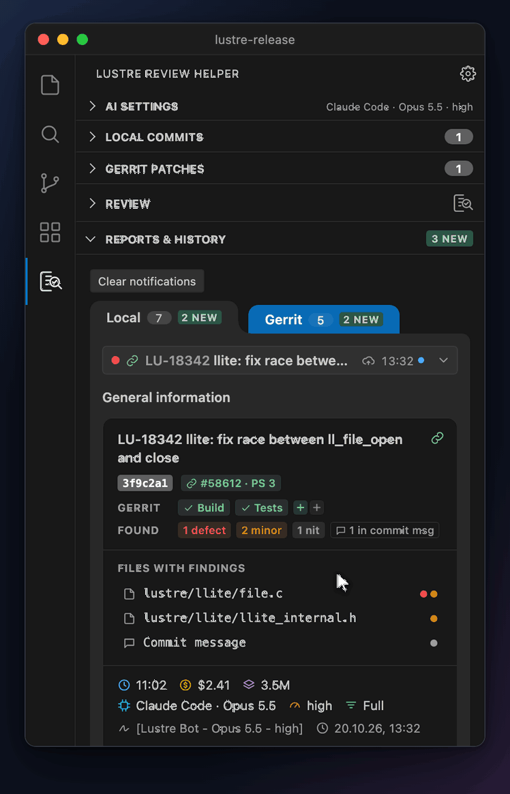
</td>
<td width="50%" valign="top">

Every review, kept per repository, in two tabs: **Local** and **Gerrit**.

- One line per review, grouped by Gerrit change or by commit with all its
  amended versions. A colored dot shows the worst finding, a cloud whether it
  is published, a blue dot that you have not read it yet.
- **Search** by change number, ticket, subject, hash or model. Quick filters:
  **New**, **To publish**, **Hide outdated**, **Hide published**, the
  **Current branch**, and the branches of your Gerrit reviews.
- A **hover card** on every line: patchsets, publication, findings by kind,
  model, time and cost.
- **General information** of the chosen review: its change on Gerrit with CI
  and votes, findings by kind, and the **files with findings**. If a newer
  patchset changed one of those files, it says so in orange.

</td>
</tr>
</table>

**Tidy by itself.** Only successful reviews of open work are kept: a failed or
cancelled review, and every review of a change that landed or was abandoned, is
deleted with its files as soon as that is known.

### Findings right in the diff

<p align="center">
  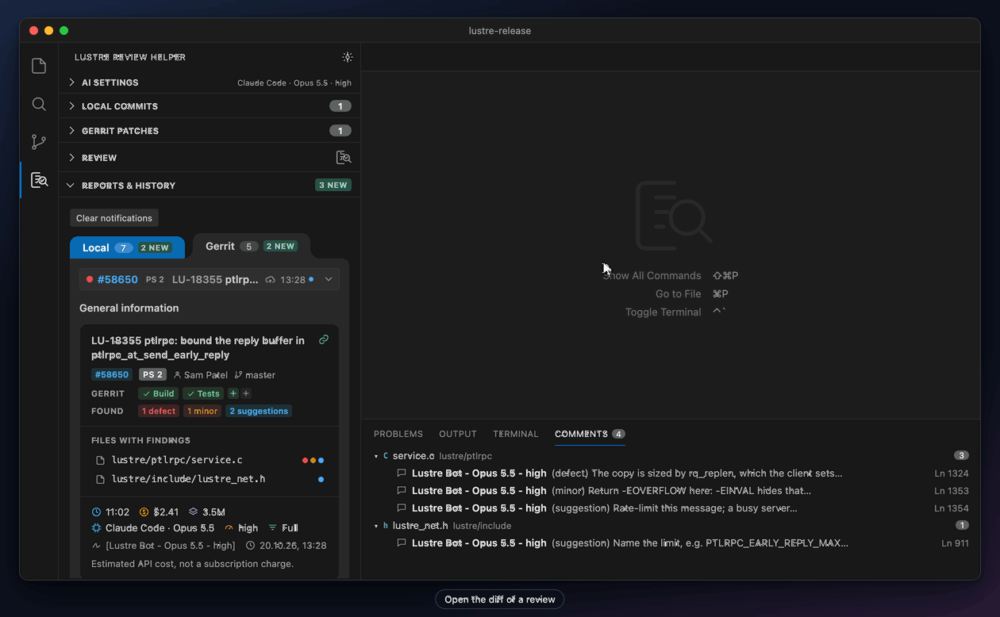
</p>

No switching to a browser to see what the review means. The diff button of any
review opens the reviewed commit against its parent in VS Code's own
multi-file diff editor:

- **Every finding sits under its line** as a comment thread, labelled
  **Defect**, **Minor**, **Suggestion** and so on, and signed by your bot.
- **The commit message comes first**, in Gerrit's layout, so its comments land
  on the same lines as on Gerrit.
- **Gerrit discussions alongside.** For a Gerrit patchset, other people's
  unresolved discussions show up next to the findings, with every reply.
- **The Comments panel** lists the findings of the chosen review by file; a
  click jumps to one. Open only the **files with comments**, or **all changed
  files**.

### Checks before you publish

An AI review goes to Gerrit only when it still fits the change. The panel keeps
track of who reviewed what, which patchset you reviewed and what changed since.

<table>
<tr>
<td width="33%" valign="top">

**👀 Someone was here first**<br>
*In the Gerrit lists*

- A change already reviewed by AI on its current patchset is marked, with
  who, the signature, when and how many comments. Signatures like
  `[AI review - opus]` and the Lustre AI review bot are recognized; a
  reviewer's `[nit]` is not taken for one.
- Your own review that is ready but not published is marked too. A click opens
  it, or names the VS Code window that holds it.
- A **new patchset** since your review brings the change back to the top of
  **In progress**.

</td>
<td width="33%" valign="top">

**🧭 The patchset moved on**<br>
*In Reports & History*

- Every review remembers the patchset it reviewed. When Gerrit has a newer
  one, it shows `PS 2 → 3`: **orange** when the new patchset changes a file
  with findings, grey when it leaves them alone.
- A **Merge conflict** chip when Gerrit can no longer merge the change into
  its branch.
- **Hide outdated** leaves out the reviews Gerrit has moved past.

</td>
<td width="33%" valign="top">

**🛡️ At the moment you publish**<br>
*Publish to Gerrit*

- The saved result must match the reviewed change, patchset and commit, or
  publishing is blocked.
- Just before posting, it reads again what every VS Code window of your
  profile has published: **a patchset gets one AI review**.
- Someone else's AI review of the same patchset is shown next to the button:
  a warning, never a block.
- The comments go to exactly the reviewed patchset, and no vote is added.

</td>
</tr>
</table>

### Publish to Gerrit

<table>
<tr>
<td width="50%" valign="top">

A Gerrit review is published with one deliberate click: unlock the button
first, then **Publish to Gerrit**. It posts the assessment and the inline
comments to exactly the reviewed patchset, signed with your bot name, and
never votes.

- **Published once, everywhere.** Publishing is recorded for every VS Code
  window of your profile: the button says **Published** with its date in each
  of them.
- The signature, such as `[Lustre Bot - Opus 5.5 - high]`, goes into the
  report and the comments.

</td>
<td width="50%" valign="top">
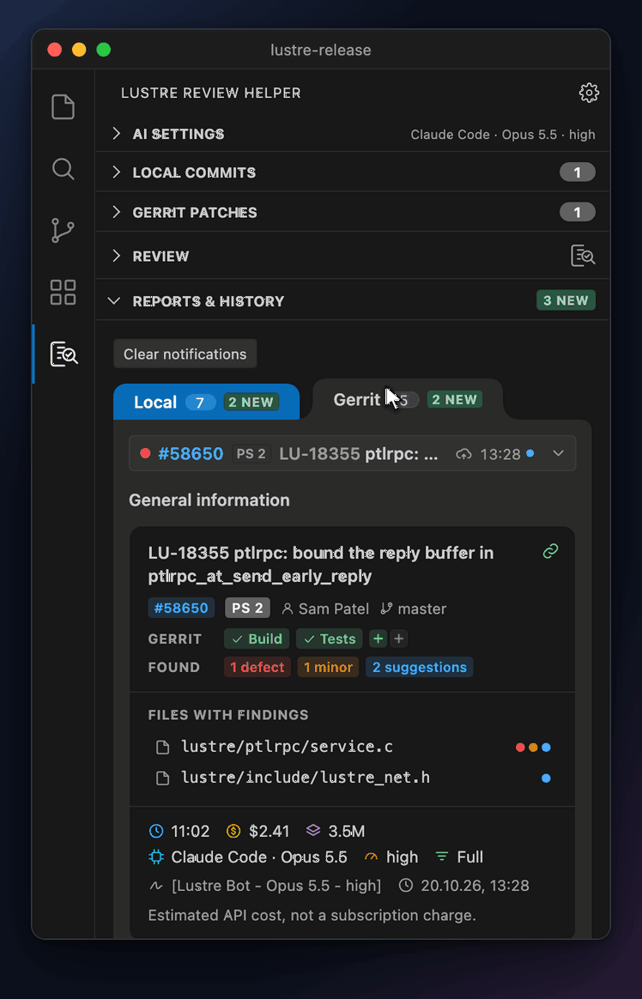
</td>
</tr>
</table>

### AI Settings

<table>
<tr>
<td width="50%" valign="top">
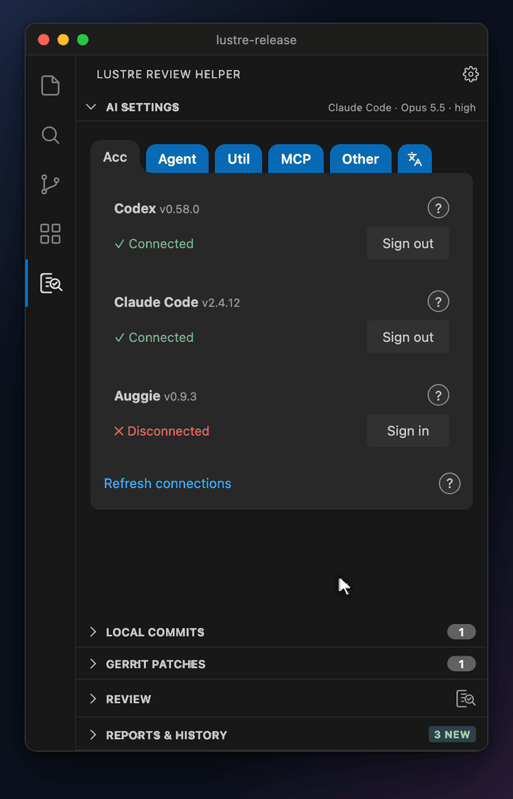
</td>
<td width="50%" valign="top">

Six folder tabs, each with a tooltip:

| Tab | What is there |
| --- | --- |
| **Accounts** | Sign in to Codex, Claude Code and Augment, with each CLI's version |
| **Agent** | Agent, model, reasoning and review depth (Full or Light) |
| **Utilities** | git, lreview, gerrit-cli and gerrit-dashboard: installed or not, versions, bot name, Gerrit connection |
| **MCP** | Connect your agents for self-review, with examples |
| **Other** | Commits to display, reset statistics, clear history |
| **🌐** | The language of the panel |

A yellow dot marks a tab that needs attention, and a review that cannot start
opens the tab with the fix.

</td>
</tr>
</table>

### Languages

<table>
<tr>
<td width="50%" valign="top">

The panel speaks **English, Deutsch, Español, 日本語, 简体中文 and Русский**,
with each language's plural forms and date order. Pick one under the
translate icon in AI Settings, or leave **Automatic**, which follows the
display language of VS Code and uses English for any other language.

Setting and command names follow VS Code's own language. What goes to Gerrit,
the review reports and the answers to agents stay in English.

</td>
<td width="50%" valign="top">
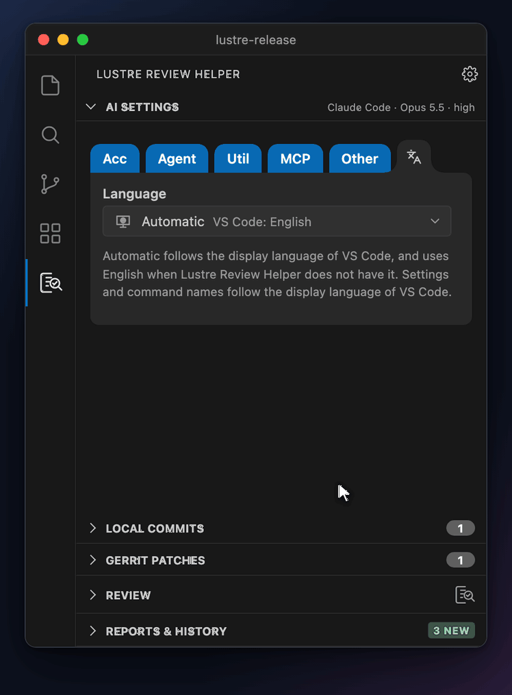
</td>
</tr>
</table>

## How it works

<p align="center">
  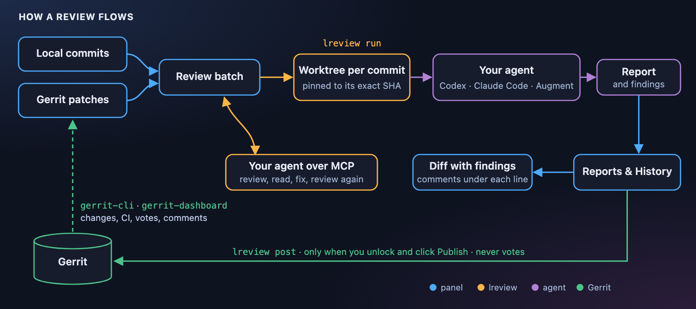
</p>

- **`lreview`** does the reviewing. The extension calls it with exact SHAs and
  patchset URLs, reads its log while it runs and its summary when it ends.
- **`gerrit-cli`** reads changes, CI, votes and comments, checks that a change
  still merges, and publishes reviews. **`gerrit-dashboard`** builds the
  Waiting Review and In progress lists.
- **Your agent's own CLI** answers the review. Its sign-in stays with it: the
  extension stores no API key and no Gerrit password.
- **Git** objects are read directly for diffs, so nothing is checked out.

## Self-review over MCP

<table>
<tr>
<td width="50%" valign="top">
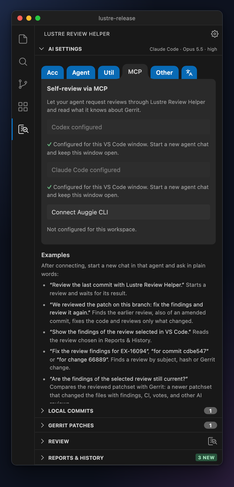
</td>
<td width="50%" valign="top">

Your coding agent can use Lustre Review Helper too. Under **AI Settings →
MCP**, click **Connect** for Codex, Claude Code or Auggie CLI, then start a new
chat in that agent and ask in plain words:

- *“Review the last commit with Lustre Review Helper.”*
- *“We reviewed the patch on this branch: fix the findings and review it again.”*
- *“Is my local patch up to date on Gerrit, or does it need a rebase?”*
- *“What is waiting for my review on Gerrit?”*

The agent finds earlier reviews (also of amended commits), fixes the code and
re-reviews **only what changed** since the last review. Reviews it starts show
up in the same panel. Agents work on local commits only: nothing is published
to Gerrit or voted on.

</td>
</tr>
</table>

<p align="center">
  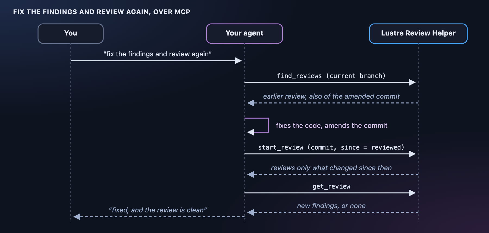
</p>

<details>
<summary><b>A line for your project's <code>AGENTS.md</code></b></summary>

```text
After committing a patch, use the lreview_vscode MCP server for an
independent Lustre review. List repositories and models, then call
start_review for the exact commit SHA, chosen agent and model. Poll get_review
until it completes (wait between polls). Examine and verify its findings;
do not treat failed, cancelled, or interrupted runs as approval. Do not
publish comments. Inside a review worker, perform the review directly:
never start another lreview review.
```

</details>

## Safe by default

- **Workspace Trust** is required: `lreview` runs agent tools on the code.
- **Nothing reaches Gerrit** until you unlock and click Publish. Reviewing never
  votes and never uploads.
- **Credentials stay where they are**: agent sign-ins in their own CLIs, the
  Gerrit account in gerrit-cli's `.env`. The extension asks for no API key.
- **Your checkout is never touched**: each review runs in its own worktree, and
  uncommitted edits are left out.
- **MCP stays local**: a Unix socket and a per-session secret, both readable
  only by you.

<p align="center">
  Every detail, from each status color and setting to every MCP field, is in the <b><a href="docs/REFERENCE.md">full reference</a></b>.
</p>

---

<p align="center">
  <sub>The pictures above are recordings of the real panel with demo data; the diff editor is drawn after VS Code's.<br>
  Reviews run in <code>lreview</code>, and Gerrit goes through <code>gerrit-cli</code> and <code>gerrit-dashboard</code>: all three from
  <a href="https://github.com/lustre-tools/llm_code_and_review_tools">LLM Code and Review Tools</a>, under its <a href="https://github.com/lustre-tools/llm_code_and_review_tools/blob/HEAD/LICENSE">BSD 2-Clause License</a>.</sub>
</p>
